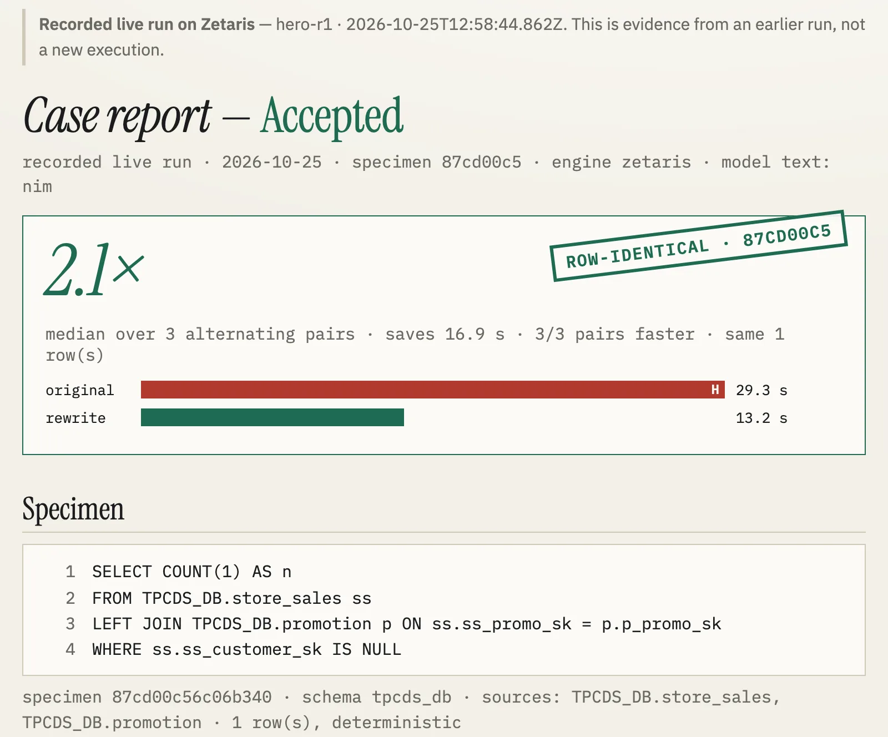

<div align="center">
  
</div>

<div align="center">
  <h1>Query Doctor 🩺</h1>
  <p><em>Same rows. Faster. Or refused. A SQL rewrite is kept only when both queries, executed on Zetaris, return identical rows and the rewrite is measurably faster.</em></p>

  <br/>

  [](https://hackathon.genai.works/event/open-agent-hackathon-2026)
  [](DEMO.md)
  [](FAILURE_MODES.md)

  <br/>

  
  
  
  
  
  [](LICENSE)

</div>

---

**Track: Reasoning Architecture.** **Problem:** whoever reviews a SQL rewrite before it merges cannot tell from the diff whether
"faster" is still the same answer. Dropping an unused `LEFT JOIN` (the shape of [trinodb/trino#2939](https://github.com/trinodb/trino/issues/2939))
leaves our Zetaris count unchanged when the joined key is unique, and turns 129,776 into 129,752 when the key repeats.
**Solution:** a model proposes; deterministic code executes both queries on Zetaris and keeps a rewrite only if the rows match on
today's data and alternating timed pairs beat the noise floor. **Built:** on the live hero the accepted rewrite ran **2.11× faster**
(median of 10 per-pair ratios; the p50s are 32,442.6 → 16,428 ms) with the same row ([`DEMO.md`](DEMO.md)); on its duplicated-key twin
every rewrite was refused, and on the trap queries no rewrite that changed rows shipped ([`evals/results.md`](evals/results.md)).
Open source (Apache-2.0), evals with a baseline arm, and written failure modes ([`FAILURE_MODES.md`](FAILURE_MODES.md)).

## 📸 See it in Action

```bash
docker build -t querydoc . && docker run --rm -p 8000:8000 -e SAMPLE_MODE=true querydoc
# open http://localhost:8000  (Intake → Report), or:
curl -X POST localhost:8000/run -H 'Content-Type: application/json' -d @input_examples/example_1.json
```

Keyless sample mode shows the Verifier, refusals and memory reuse on DuckDB with recorded model answers; its recorded runs have no ACCEPT (a keyless run on another machine can differ:
`output_examples/expected.json` allows ACCEPTED for examples 2, 4 and 6). The
accepted speedup is the recorded live Zetaris run, which the same container replays at `http://localhost:8000/#/recorded/hero-r1`
(and its refused twin at `#/recorded/hero-trap-r1`). That screen is one recorded run, 2.1× over 3 alternating pairs; the
headline 2.11× is the 10-pair benchmark in [`DEMO.md`](DEMO.md).



Recorded runs, each with its Markdown dossier and Hub-schema trace: [`recorded/live/`](recorded/live/README.md) (Zetaris),
[`recorded/sample/`](recorded/sample/) (DuckDB). A dossier shows the diagnosis, every attempt with its verdict, the differing
row when rows changed, and the paired timings.

## 💡 The Problem & Solution

### The Problem
A slow query is cheap to rewrite and expensive to trust. An LLM (or a hurried human) can turn a `LEFT JOIN` into an inner join, drop
a join whose key is not unique, or change a `NOT IN` into something with different NULL behaviour, and the result is a query that is
faster **and wrong**. Reviewers cannot tell from the diff.

### The Solution
Three agents and an orchestrator, one rule: **a model never decides.**

1. **Diagnoser** reads the Zetaris `EXPLAIN` plan, a static pattern detector and SQL-aggregate key facts (is the join key unique?).
2. **Rewriter** proposes one rewrite per hypothesis, seeing the refusals so far.
3. **Verifier** (no model) runs original and rewrite on the engine: determinism pre-check → schema check → row diff (or an engine-side
   row-hash fingerprint above the row cap) → alternating paired timing. ACCEPT needs identical rows, ≥ 1.2×, a saving above the noise
   floor and most pairs won.
4. **Orchestrator** sequences the case; a refusal goes back to the Rewriter; a correct rewrite with no real gain (`no_gain`) goes to `Diagnoser.revise`, one that
   misses another speed gate (`under_gate`) goes back to the Rewriter.

Nothing is applied to your database. An accepted case is a candidate with a patch file for a human to review.

### Related work
Engine optimizers apply fixed rules, safely, but only the rules they have (join elimination for the hero's shape is an open request in Trino, #2939). A model asked
for a rewrite in one call proposes edits nothing has executed. Our baseline arm is exactly that: one plain model call, scored by the same Verifier; it changed rows
in 6 of 15 sample runs and was faster-and-identical in 0 of 15 (`evals/results.md`). Query Doctor's recorded sample runs have no ACCEPT either;
the difference is that none of its changed-row rewrites shipped. The hero is the shape from
[trinodb/trino#2939](https://github.com/trinodb/trino/issues/2939), re-expressed on `TPCDS_DB`.

## 🏗️ Architecture & Tech Stack

```
SQL → guard → Verifier.precheck → EXPLAIN + pattern detector + key profile → Diagnoser
    → Markovian chain (≤ 3 attempts): H-MEM retrieve → Rewriter → Verifier ─┬ ACCEPT → ACCEPTED
                                                                              ├ ROW_DIFF → playbook write → retry
                                                                              └ no_gain → Diagnoser.revise
```

Full walk-through and file map: [`ARCHITECTURE.md`](ARCHITECTURE.md).

| Layer | Choice |
|---|---|
| Language / runtime | TypeScript, Node 22 (`tsx`); Java 17 sidecar for JDBC |
| Live engine | local Zetaris platform over the Lightning JDBC driver |
| Sample engine | DuckDB on a committed NYC TLC subset (keyless) |
| Memory / reasoning | Meterless H-MEM and Markovian, vendored in `vendor/meterless/` |
| Model | NVIDIA Nemotron 3 Ultra (`nvidia/nemotron-3-ultra-550b-a55b`) via Meterless Nightshift (default adapter) or direct NIM (fallback) |
| API / UI | `POST /run` on port 8000, a single Intake + Report page in `web/` |
| Packaging | Docker (keyless image), GitHub Actions |

## 🏆 Sponsor Integration

### Zetaris
The live path runs against the **local Zetaris platform over JDBC**: `src/engine/zetaris.ts` plus the sidecar
`engine/zetaris-jdbc/QuerySidecar.java` (one warm connection, one JSON line per request). Query Doctor executes the original and every
rewrite there, reads the Spark physical plan with `EXPLAIN FORMATTED`, fingerprints results on the engine (`xxhash64`) and times
them. The local bundle has **no MCP endpoint**, so we use none of the four documented MCP tools (`get_slow_queries`,
`get_query_stats`, `profile_table`, `explain_query`): intake is pasted SQL, profiles are SQL aggregates, plans come from `EXPLAIN`, timing is
our own wall clock. Details and the other things we hit: [`docs/DX-REPORT.md`](docs/DX-REPORT.md).

### Meterless
- **H-MEM** is the playbook (`src/memory/playbook.ts`): the Verifier writes refusals and verified outcomes; the next attempt retrieves by
  pattern and schema; an identical refused candidate is reused from the ledger without running it again (`example_3`).
- **Markovian** is the rewrite chain (`src/reasoning/chain.ts`): one attempt is one chunk, the carryover (hypothesis ledger plus
  rejected attempts) is what the next attempt sees.
- **Nightshift** is the default model provider (`src/adapters/nightshift.ts`, contract-following, 16 mock-runtime tests in test/nightshift.test.ts).
  **It was not run against a live Nightshift runtime.** All recorded runs used direct NVIDIA NIM, the declared fallback
  (`LLM_PROVIDER=nim`), and every recorded trace that contains a model call names `nim` (`sponsor_call.service`). We do not claim a Nemotron-through-Nightshift run.

### NVIDIA
Nemotron 3 Ultra serves the Diagnoser and Rewriter. The model that answered is recorded in each trace line and case.

### Cursor
Dev environment: Cursor's agent wrote the scaffold commit only (`d3e823c`). Everything else was built with Claude Code.

### AI usage disclosure
- **Code:** every commit except the scaffold carries `Tool: claude-code` (Claude Code); the scaffold carries `Tool: cursor` and
  `Co-authored-by: Cursor`. `git log --format='%h %(trailers:key=Tool,valueonly)'` lists them.
- **Review:** an outside panel of four models (Qwen, Grok, Codex, Claude Opus) reviewed the code and architecture in two rounds and the judge-facing copy in one
  (transcripts not published); each finding was checked against the code before a change, and the fixes are commits prefixed `a2a r03` / `a2a r04` / `a2a r05`.
- **Runtime:** a model proposes diagnoses and rewrites. The verdict, every number and every timing come from code.
- **Pre-existing:** `vendor/meterless/` (upstream engines, unmodified) and the public NYC TLC data in `data/sample/`. The visual suite in
  `docs/assets/` (icon, animated icon and hero, README hero, social and gallery cards) and the colour and type direction were designed
  on 15–21 Oct, before the build window, and copied into this repo on 26 Oct; no product code or data predates the window.

## 📊 Engineering Rigor

| Metric | Value | Source |
|---|---|---|
| Tests | **286 tests, 26 files** (vitest) | `npm test` |
| Hero on Zetaris (TPCDS_DB, local JDBC) | 2.11× median, 10/10 pairs faster | [`DEMO.md`](DEMO.md) |
| Live accepted runs | hero 2.1× and 2.15×; correlated-avg 1.44× (rows identical); 3 hero takes filmed for the video, 2.13× · 2.11× · 2.32× | [`recorded/live/README.md`](recorded/live/README.md), [`evidence/video/`](evidence/video/README.md) |
| Rewrites shipped with changed rows | 0 | an ACCEPT requires an identical row fingerprint |
| Baseline arm (one model call, same Verifier) | 6/15 changed rows, 0/15 identical and faster | [`evals/results.md`](evals/results.md) |
| Dependencies | `npm audit --omit=dev`: 0 vulnerabilities | `npm audit` |

### Attacks defeated
| Control | Why load-bearing | Test |
|---|---|---|
| Single read-only statement | a rewrite cannot write or run a second statement | `test/guard.test.ts` |
| Rows compared by execution | a faster wrong query is a REJECT with the differing row | `test/verifier.test.ts`, `test/canonical-diff.test.ts` |
| Determinism lint + double run | `rand()`, `now()`, unordered `LIMIT` cannot fake equal rows | `test/determinism.test.ts` |
| Paired alternating timing + noise floor | one lucky run cannot ACCEPT | `test/timing.test.ts` |
| Host / Origin check on live mode | DNS rebinding cannot reach a local live instance | `test/server-body.test.ts` |

### Limitations
Read [`FAILURE_MODES.md`](FAILURE_MODES.md). The short list:
- The queries in the evals are ones we designed (hero, traps, controls); N is small (live hero: 2 recorded runs + 3 filmed takes, all ACCEPT) and the shares are not a rate on real workloads.
- The sample (DuckDB) pack has **no ACCEPT**; the accepted speedup is live Zetaris only. A hand-written sample rewrite benchmarks 16.24× faster with identical rows (`DEMO.md`); the Verifier's verdict on it is machine-dependent and not recorded, and some examples' verdicts vary by machine (`output_examples/expected.json`).
- The retry loop does not reliably learn from a refusal: on the duplicated-key hero trap the first two attempts changed the rows when executed (one dropped the join, one swapped it for a LEFT SEMI JOIN) and the third repeated the first and was refused from the ledger without running, although the prompt carried the measured fact that the key is not unique.
- Nightshift was never run live; there is no hosted CI run to cite (GitHub Actions did not start on the private repo).
- Floats compare to 9 significant digits; the speedup is one laptop over local JDBC and says nothing about a hosted deployment.

### What we got wrong
- We planned on Zetaris' MCP tools; the local platform has none, so we rebuilt the engine layer over JDBC on day 1.
- We expected a 5–12 s hero; it runs about 35 s, so one live verification takes minutes, not seconds.
- We first called the NVIDIA endpoint directly and added Meterless Nightshift as the provider later, so the recordings predate it.
- We specified Nemotron 3 Super and switched to Nemotron 3 Ultra mid-build.

## 🚀 Getting Started

### Prerequisites
- Docker, **or** Node 22. No GPU. Sample mode needs no key and no network.
- Live mode additionally: JDK 17 on `PATH` (`javac` compiles the sidecar on first use), the Zetaris JDBC jar, and a model credential.

### Installation
```bash
cp .env.example .env            # empty values = keyless sample mode
npm ci
npm start                       # API + UI on http://127.0.0.1:8000
npx tsx run.ts input_examples/example_1.json --sample   # CLI: prints the Markdown dossier
```

Live mode: fill `ZETARIS_*` (and, for a model, `METERLESS_BASE_URL`, `METERLESS_RUNTIME_TOKEN`, `METERLESS_MODEL`, or `LLM_PROVIDER=nim`
with `NVIDIA_API_KEY`) in `.env` or `~/.config/querydoc/*.env`, then `npm start`. `npm start` listens on `127.0.0.1`; set `HOST=0.0.0.0` to expose it (the image does).
Live mode answers only on `localhost`, an IP address or `QUERYDOC_ALLOWED_HOSTS` names.

### API
`POST /run` with `{"input":{"sql":"…","candidate_sql":"…"},"options":{"sample_mode":true}}` · `GET /runs/:id` · `GET /runs/:id/trace` ·
`POST /runs/:id/decision` · `GET /playbook` · `GET /slow-queries` · `GET /traces/recorded` · `GET /health`.

## 🧪 Testing & CI

```bash
npm run typecheck && npm test        # 286 tests, no keys needed
npm run test:offline                 # replay parity of the recorded packs
npm run bench                        # → DEMO.md        npm run eval   # → evals/results.md
docker run --rm querydoc npm test    # the same suite in the image
```

CI (`.github/workflows/`): typecheck, tests, `npm audit --omit=dev`, a keyless Docker job (builds the image, starts it in
`SAMPLE_MODE`, POSTs all six `input_examples/`), and gitleaks over the full history. No hosted run is cited because Actions
did not start on the private repo (account billing); the same steps were replayed locally in a clean clone (`scripts/clean_clone.sh`, examples 1–3).

### Hub validation flow (this repo's names)
```bash
git clone <repo-url> final-check && cd final-check
ls run.ts README.md .env.example input_examples/ output_examples/
docker build -t querydoc .
docker run --rm -p 8000:8000 --env-file .env querydoc          # or -e SAMPLE_MODE=true with no .env; the image has no JDK, so live Zetaris runs with `npm start` on the host
curl -X POST localhost:8000/run -H 'Content-Type: application/json' -d @input_examples/example_1.json   # also example_2 … example_6
ls logs/ && cat logs/*.jsonl | head -50                          # committed traces; live runs write data/runs/<id>/trace-<id>.jsonl
grep -RIn --exclude-dir=.git --exclude-dir=node_modules -E "(sk-|nvapi-|api[_-]?key|secret|token|password)" .
rm .env && docker run --rm -p 8000:8000 -e SAMPLE_MODE=true querydoc   # no credentials at all
```
`example_1` is a tempting rewrite supplied as `candidate_sql` (refused deterministically); `example_3` reuses that refusal from the
playbook ledger without executing it (its verdict line reads `NO_SAFE_REWRITE — llm_unavailable` because, with no key, there is no model to write a second rewrite); `example_5` ends `NOT_VERIFIABLE` (non-deterministic query). With no model key, rewrites come
from the committed `llm-cache/`; a cache miss gives a partial dossier, never an invented rewrite.

### Hub readiness checklist
- [x] `run.ts`, `README.md`, `.env.example` (empty values), `input_examples/` and `output_examples/` (6 each)
- [x] Runs from a clean clone, keyless (`scripts/clean_clone.sh`, examples 1–3); no local GPU
- [x] `POST /run` on port 8000; `SAMPLE_MODE=true` works with no Zetaris, Nightshift or key
- [x] `logs/` traces (copies of recorded runs) name ≥ 2 agents (Diagnoser, Rewriter, Verifier, Orchestrator) and show critique, retry and revise events across the three files
- [x] No secrets in the tree (gitleaks clean); credentials live outside it
- [x] Limitations stated ([`FAILURE_MODES.md`](FAILURE_MODES.md)); pre-existing components declared above
- [ ] Hosted green CI run, live Nightshift recording: **not done**, see Limitations

## 📁 Project Structure

```
src/agents/     diagnoser · rewriter · verifier · patterns · profile      src/verify/    canonical · diff · determinism · timing
src/engine/     zetaris (JDBC) · duckdb · sparkPlan                       src/adapters/  nightshift · nim · llm
src/memory/     H-MEM playbook        src/reasoning/  Markovian chain     src/guard/     read-only SQL guard
engine/zetaris-jdbc/  Java sidecar    vendor/meterless/  upstream engines  web/           Intake + Report
recorded/ evals/ evidence/ logs/      input_examples/ output_examples/      data/          sample data
```

## 🗺️ Roadmap
- [x] Verifier gate, paired timing, determinism pre-check
- [x] H-MEM playbook and Markovian chain
- [x] Live Zetaris path and keyless DuckDB sample mode
- [ ] Re-record hero and one other example through a live Nightshift runtime
- [ ] Zetaris MCP tools when an endpoint is available (`get_slow_queries` intake, `profile_table`)
- [ ] A query set not designed by us; the baseline arm on Zetaris
- [ ] Write-back of an approved rewrite to the source (today a human applies the patch)

## 📽️ Demo Materials
Measured numbers and how to reproduce them: [`DEMO.md`](DEMO.md).
Landing page: https://querydoc-flax.vercel.app/ · pitch deck: https://querydoc-flax.vercel.app/deck/ ([PDF](https://querydoc-flax.vercel.app/deck/querydoc-deck.pdf)) — both are static pages in [`docs/`](docs/). The demo video is linked in the submission form.

## 📄 License
Apache-2.0, see [`LICENSE`](LICENSE). `vendor/meterless/` keeps its upstream LICENSE and NOTICE. Security: [`SECURITY.md`](SECURITY.md).

## 🙏 Acknowledgments
Zetaris, Meterless and NVIDIA for the platform, engines and models; the NYC Taxi & Limousine Commission for the sample data;
[trinodb/trino#2939](https://github.com/trinodb/trino/issues/2939) for the hero's shape.
